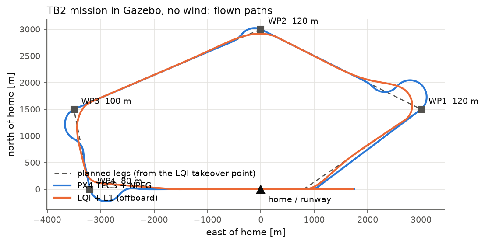
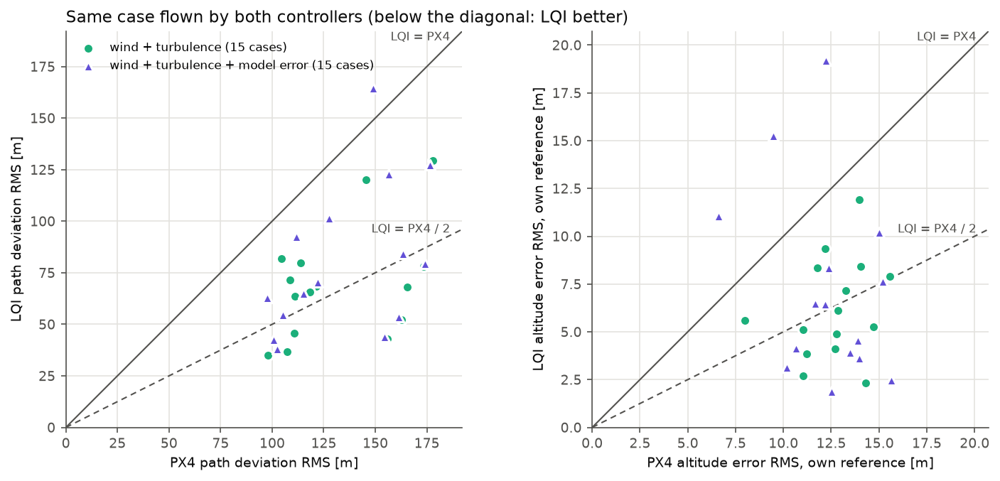
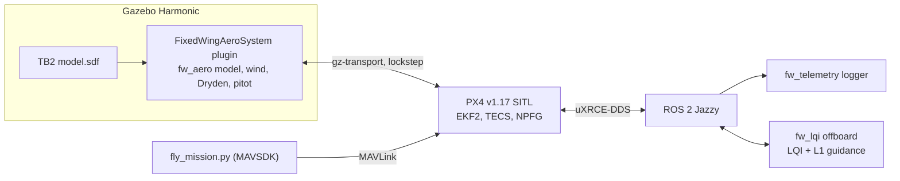

# Fixed-wing UAV in PX4 SITL + Gazebo Harmonic + ROS 2


A TB2-class MALE fixed-wing UAV simulated end to end. The aircraft's aerodynamics,
propulsion, wind and turbulence come from a custom Gazebo Harmonic plugin. Two
autopilots fly the same mission: the stock PX4 v1.17 TECS/NPFG controllers and an
LQI + L1 offboard controller written in ROS 2 Jazzy. The two are then compared in
60 Monte Carlo flights with wind, Dryden turbulence and model error.

**Highlights**

- C++ port of a validated Python 6-DoF aero model (`fw_aero`) with gtest unit tests
  and Python parity tests, wrapped as a Gazebo system plugin (`fw_aero_gazebo`).
- Complete PX4 SITL mission with no manual steps: runway takeoff, four waypoints
  and an automatic landing.
- LQI with integral action, designed on the linearized 6-DoF model. It flies the
  aircraft through PX4's offboard *direct actuator* interface over uXRCE-DDS.
- Steady wind and MIL-F-8785C Dryden turbulence. The plugin also models the pitot
  tube, so PX4 sees air-relative airspeed instead of ground speed.
- Resumable Monte Carlo campaigns: **60/60 flights completed**. LQI path RMS was
  **0.55 to 0.56x** PX4's (median of paired cases), lower in 15/15 cases in wind
  and 14/15 with model error added.
- Docker image that flies a mission headless. GitHub Actions CI runs 75 tests.





*Each point is one Monte Carlo case flown by both controllers with the same wind,
turbulence seed and model error. Points below the diagonal are cases where LQI did
better. The altitude panel scores each controller against the reference it
actually tracks (see [Results](#results)).*

## Architecture



| Package / folder | What it is |
|---|---|
| `src/fw_aero` | C++ aero model: forces, moments, propulsion, wind and Dryden turbulence. Has gtest tests that check parity with the Python reference. |
| `src/fw_aero_gazebo` | Gazebo system plugin, TB2 SDF model and test worlds (runway, glide, windy and scaled glide). |
| `src/fw_lqi` | LQI controller, L1 guidance and PX4 interface (frames, actuator mapping), plus the offboard ROS 2 node. |
| `src/fw_telemetry` | ROS 2 telemetry logger for PX4 topics. |
| `scripts/` | `run_sitl.sh` launches Gazebo + PX4, `fly_mission.py` uploads and flies the mission, `run_flight.py` runs one unattended flight, `monte_carlo.py` runs campaigns. |
| `tools/` | Trim, linearization and LQI design; 6-DoF simulations; ULog analysis and scoring; figures. |
| `px4/tb2_params.env` | PX4 parameters for the TB2 airframe. |
| `results/` | Monte Carlo cases, per-flight metrics and summaries. |
| `docker/`, `ci/`, `.github/` | Docker image, CI scripts and the GitHub Actions workflow. |

## Quick start

### Docker (everything included)

The image contains ROS 2 Jazzy, Gazebo Harmonic, PX4 v1.17.0 SITL, the
Micro XRCE-DDS Agent, `px4_msgs`, this workspace and the Python venv. It is about
12 GB.

```bash
docker build -t fw-uav-sitl -f docker/Dockerfile .
docker run --rm -it fw-uav-sitl python scripts/run_flight.py --controller lqi --out /tmp/flight
```

`run_flight.py` boots Gazebo headless, starts PX4 and the Agent, flies the whole
mission and writes `result.json` (success, reason, ULog path, wall time).

### Native (Ubuntu 24.04)

Requirements:

- ROS 2 Jazzy and Gazebo Harmonic (gz-sim 8).
- PX4-Autopilot v1.17.0 built with `make px4_sitl` in `~/PX4-Autopilot`. Set
  `PX4_DIR` to use another path.
- A ROS 2 underlay `~/px4_ros_ws` with Micro-XRCE-DDS-Agent v2.4.3 and
  `px4_msgs` at tag `v1.17.0`.
- The reference Python model
  [SirPicklee/uav-6dof-autopilot](https://github.com/SirPicklee/uav-6dof-autopilot),
  used by the design tools.

```bash
source /opt/ros/jazzy/setup.bash && source ~/px4_ros_ws/install/setup.bash
colcon build && colcon test && colcon test-result --verbose
python3 -m venv --system-site-packages .venv && source .venv/bin/activate
pip install --ignore-installed -r requirements.txt
```

Manual run (one terminal each):

```bash
scripts/run_sitl.sh                 # Gazebo GUI + PX4 (HEADLESS=1 for server only)
MicroXRCEAgent udp4 -p 8888         # ROS 2 bridge
python scripts/fly_mission.py tb2   # takeoff, waypoints, landing with PX4
```

One unattended flight, optionally with wind, turbulence, model error or faster
than real time:

```bash
python scripts/run_flight.py --controller px4 --wind "0 -8 0" --w20 7.7 --seed 3 \
    --model "mass=1.05 lift=0.95 drag=1.1" --speed 4 --out /tmp/flight
```

Monte Carlo campaigns (resumable: rerun the same command to continue):

```bash
python scripts/monte_carlo.py --cases 15 --seed 2026 --speed 4 --out ~/fw_mc/campaign1
python scripts/monte_carlo.py --cases 15 --seed 2026 --speed 4 --uncertainty --out ~/fw_mc/campaign2
```

`tools/analyze_monte_carlo.py` turns a campaign into the per-case table, the
metric distributions, the paired ratios and `metrics.csv`.

### CI locally

The workflow runs `ci/install_deps.sh` and `ci/build_and_test.sh` in the
`ros:jazzy-ros-base` container. The same thing locally, on a copy of the
repository:

```bash
docker run --rm -v "$PWD":/src:ro ros:jazzy-ros-base bash -c \
  "cp -r /src /ws && cd /ws && rm -rf build install log .venv && bash ci/install_deps.sh && \
   git clone --depth 1 --branch v1.17.0 https://github.com/PX4/px4_msgs.git src/px4_msgs && \
   bash ci/build_and_test.sh"
```

## Validation

Each layer was checked against an independent reference before the next one was
built on top of it.

| Check | Result |
|---|---|
| C++ aero model vs Python reference | gtest parity tests on forces and moments |
| Gazebo glide vs Python 6-DoF, with wind | within 0.26 m |
| Gazebo glide vs Python, scaled model (lift, drag, mass) | within 0.28 m (792 m vs 992 m nominal glide distance) |
| Takeoff roll, 8 m/s headwind | 160 m vs 336 m in calm air, consistent with 22.6 m/s ground speed at rotation |
| ROS 2 telemetry vs PX4 ULog | 0.11 m position, 0.045 deg attitude |
| LQI shadow mode (commands computed, not applied) | compared against PX4's own actuator outputs before engaging |
| Lockstep at 4x real time | same mission metrics as 1x, within run-to-run spread |
| Docker image | full mission completed headless |

## LQI controller

Trim and linearization come from the nonlinear 6-DoF model at 45 m/s and 100 m:
alpha 1.85 deg, elevator 0.43 deg, throttle 0.61. The longitudinal and lateral
designs are decoupled, and each is augmented with integrators:

- **Longitudinal**, state `[u, w, q, theta, e_h, xi_v]` (altitude error plus an
  airspeed integral), inputs elevator and throttle.
  `Q = diag(0.1, 1, 1, 10, 0.5, 0.5)`, `R = diag(100, 1)`.
- **Lateral**, state `[v, p, r, phi - phi_ref, xi_phi]`, inputs aileron and rudder.
  Bryson-style weights: 30 deg bank, 20 deg aileron, 15 deg rudder.
- **Guidance**: L1 (Park, Deyst, How) with L1 = 400 m, a 400 m waypoint switch
  distance and a 30 deg bank limit.

`tools/lqi_design.py` checks the Riccati residual and writes
`src/fw_lqi/config/lqi_gains.yaml`. The design was first flown in the Python
6-DoF (`tools/lqi_sim.py`, `tools/lqi_mission_sim.py`) and then in Gazebo.

PX4 takes off and climbs out. The node then switches PX4 to offboard
(`MAV_CMD_DO_SET_MODE`) and flies the waypoint legs through `direct_actuator`
servo and motor commands. At the end it hands back with `MAV_CMD_DO_LAND_START`,
and PX4 lands. Navigation runs in the home frame, which is latched at arming.

## Results

### Calm air

| Metric (same mission, fresh boot) | PX4 TECS/NPFG | LQI + L1 |
|---|---|---|
| Path deviation RMS | 108 m | 51 m |
| Altitude error after settling, own reference | 1.3 to 2.2 m | 0.5 to 0.8 m |
| Control effort | equal | equal |

PX4 is better in the 55 m to 120 m climb. LQI's altitude step is limited by the
excess thrust available, while TECS follows a ramped reference.

### Monte Carlo (15 cases per campaign, seed 2026, each case flown by both)

Steady wind 0 to 10 m/s from a random direction, Dryden W20 0 to 15.4 m/s. The
second campaign uses the same winds and adds model error: mass ±10 %, lift ±10 %,
drag ±20 %, pitch stiffness ±20 %, control power ±20 % and thrust ±10 %.

| Median (p90 / worst) | Wind + turbulence: PX4 | LQI | + model error: PX4 | LQI |
|---|---|---|---|---|
| Path deviation RMS [m] | 118 (170 / 178) | 68 (105 / 129) | 128 (170 / 177) | 71 (126 / 165) |
| Altitude RMS, own reference [m] | 12.8 (14.6 / 15.6) | 5.6 (9.0 / 11.9) | 12.4 (15.1 / 15.6) | 6.4 (13.6 / 19.2) |
| Airspeed error RMS [m/s] | 1.26 (1.48 / 1.74) | 1.35 (1.49 / 2.09) | 1.41 (2.87 / 3.27) | 1.47 (2.06 / 2.18) |
| Max bank [deg] | 38.0 (38.3 / 38.5) | 34.5 (35.2 / 35.4) | 37.7 (38.8 / 39.1) | 34.3 (35.1 / 35.2) |
| Lowest min airspeed [m/s] (stall 26) | 30.4 | 30.6 | 30.5 | 30.8 |
| Mean throttle | 0.66 | 0.66 | 0.66 | 0.69 |

| Paired ratio LQI/PX4 (median, LQI better in) | Wind + turbulence | + model error |
|---|---|---|
| Path deviation RMS | 0.55, 15/15 | 0.56, 14/15 |
| Altitude RMS, own reference | 0.48, 15/15 | 0.50, 12/15 |
| Airspeed error RMS | 1.09, 7/15 | 1.06, 6/15 |
| Mean throttle | 1.00, 5/15 | 1.01, 6/15 |

How to read this:

- **Path.** LQI tracks the legs about twice as tightly. Part of that comes from
  the corner strategy: L1 with a 400 m lead turns early onto the next leg, while
  NPFG flies to the waypoint and overshoots the turn. This is also why LQI's
  mission legs take about 240 s against PX4's 288 s.
- **Altitude.** Each controller is scored against its own reference: a step for
  LQI, TECS's ramp for PX4. With model error, LQI's worst cases are all in the
  first-leg climb, which is thrust-limited (for example 35.7 m RMS on leg 1 of
  case 2, while legs 2 to 4 stay at 1 to 2 m).
- **Airspeed and effort.** These are on par. Model error doubles PX4's worst
  airspeed error (1.7 to 3.3 m/s), while LQI stays at about 2.1 m/s. Neither
  controller came within 4 m/s of stall.

Full per-flight metrics are in `results/mc_wind_turbulence/` and
`results/mc_model_uncertainty/`.

## Lessons learned

- **PX4 parameters equal to the firmware default can be silently lost.** A
  `PX4_PARAM_` value that equals the firmware default is overwritten by the
  airframe's own defaults (rc_cessna, 4003). This affected `SENS_EN_ARSPDSIM=0`
  (a second, simulated airspeed sensor appeared) and `NAV_DLL_ACT=0` ("No
  connection to the GCS" failsafe in Docker). `run_sitl.sh` now sets both again
  after the commander starts and stops `sensor_airspeed_sim`.
- **Home vs EKF local origin.** The EKF local origin drifted up to 1.8 km from
  home. All navigation and scoring moved to the home frame, using the *first*
  valid `home_position`, because home moves again after landing.
- **Transient-local topics and late subscribers.** A node that subscribes late
  can miss `home_position`. The offboard node now latches home from the global
  position at arming.
- **The pitot tube must see the wind.** Gazebo's air-speed sensor ignores wind,
  so the plugin publishes the pitot pressure itself. On the ground in wind the
  pitot reads the wind speed, so `LNDFW_AIRSPD_MAX=20` was needed for PX4 to
  detect the landing.
- **Check hypotheses against data.** I first blamed LQI's altitude error on a
  missing altitude integrator. The logs showed that cruise error was already
  1 to 2 m, and that the real cause was the thrust-limited first climb.
- **Automation hygiene.** An orphaned mission script once re-armed PX4 in the
  middle of a flight. The flight runner now runs each process in its own process
  group, kills leftovers before every flight, and uses line-buffered logs.

## Limitations and future work

- LQI was designed on the same model that the simulator flies; model error was
  only tested in campaign 2. PX4 uses rc_cessna gains with only the TB2-specific
  parameters changed, so it is not tuned for this airframe.
- There is one mission geometry and one corner strategy. Part of the path
  advantage is the 400 m L1 lead.
- The Dryden lateral and vertical gusts are first-order Gauss-Markov
  approximations of the MIL-F-8785C spectra.
- Future work:
  - A rate-limited altitude reference for the LQI climb.
  - Gain scheduling over airspeed and altitude.
  - More mission geometries.
  - Sensor noise and actuator faults in the Monte Carlo.

## Acknowledgements

The aerodynamic model, the trim tools and the 6-DoF reference come from my earlier
project [uav-6dof-autopilot](https://github.com/SirPicklee/uav-6dof-autopilot).
Built on [PX4](https://px4.io), [Gazebo](https://gazebosim.org) and
[ROS 2](https://docs.ros.org).
